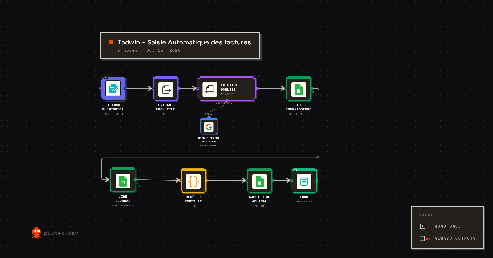

# Tadwin – Saisie automatique des factures avec n8n

Tadwin transforme une facture d'achat PDF en écriture comptable (PCGE marocain) et l'enregistre dans un journal Google Sheets, avec des contrôles automatiques avant validation.

## Le problème

La saisie manuelle des factures prend du temps et génère des erreurs : mauvais compte, TVA mal calculée, facture enregistrée deux fois.

## Ce que fait le workflow

1. L'utilisateur envoie une facture PDF via un formulaire n8n.
2. Le texte du PDF est extrait.
3. Une IA (Gemini) lit la facture et renvoie des données structurées : fournisseur, ICE, numéro, date, HT, taux de TVA, TVA, TTC.
4. Le compte de charge est choisi à partir de la liste des fournisseurs connus. Si le fournisseur est nouveau, l'IA propose un compte parmi une liste PCGE autorisée.
5. Un nœud Code génère l'écriture d'achat et lance les contrôles.
6. Les lignes sont ajoutées au journal Google Sheets, et un onglet de synthèse se met à jour.

### Écriture générée

| Compte | Libellé | Débit | Crédit |
|---|---|---|---|
| 61xx | Charge (HT) | 4 250,00 | |
| 34552 | État, TVA récupérable sur les charges | 850,00 | |
| 4411 | Fournisseurs | | 5 100,00 |

## Contrôles automatiques

Une facture qui échoue à un contrôle est enregistrée avec le statut **À vérifier** et le motif de l'anomalie.

- HT + TVA = TTC
- TVA = HT × taux
- Taux de TVA valide pour l'année de la facture (réforme 2024-2026 : disparition du taux de 14 %)
- Équilibre débit = crédit
- Doublon (même fournisseur et même numéro de facture)
- Nouveau fournisseur : compte proposé par l'IA, validation humaine requise

## Tests

| Facture | Cas testé | Résultat attendu |
|---|---|---|
| 01 | Fournitures, fournisseur connu | Validé |
| 02 | Internet, fournisseur connu | Validé |
| 03 | Transport à 10 % | Validé |
| 04 | Nouveau fournisseur | À vérifier |
| 05 | TTC erroné | À vérifier |
| 06 | Doublon de la 02 | À vérifier |
| 07 | Taux de 14 % en 2026 | À vérifier |

## Contenu du dépôt

- `workflow/` : le workflow n8n à importer (JSON)
- `code/code_generer_ecriture.js` : génération de l'écriture et contrôles
- `prompts/extracteur_ia.md` : schéma JSON et prompt de l'extracteur IA
- `data/comptabilite_n8n.xlsx` : journal, fournisseurs, plan de comptes et synthèse
- `factures_test/` : 7 factures fictives couvrant chaque cas
- `captures/` : captures d'écran

## Installation

1. Importez `comptabilite_n8n.xlsx` dans Google Drive et convertissez-le au format Google Sheets.
2. Dans n8n, importez le workflow (menu ⋯ → Import from File).
3. Configurez les credentials : Google Sheets (OAuth2) et un modèle IA (Gemini, OpenAI ou Anthropic).
4. Sélectionnez votre classeur dans les nœuds Google Sheets.
5. Lancez le workflow et envoyez les factures de test dans l'ordre.

## Stack

n8n · Google Gemini · Google Sheets · JavaScript

## Limites et pistes d'amélioration

- Factures d'achat avec un seul taux de TVA (pas encore de factures de vente, d'avoirs ni d'immobilisations)
- PDF texte uniquement (un OCR serait nécessaire pour les factures scannées)
- Prochaines étapes : ajout automatique des fournisseurs validés, rapprochement bancaire, préparation de la déclaration de TVA

Les entreprises, ICE et montants utilisés dans ce projet sont fictifs. Les taux de TVA sont à vérifier sur tax.gov.ma avant tout usage réel.
